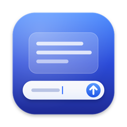
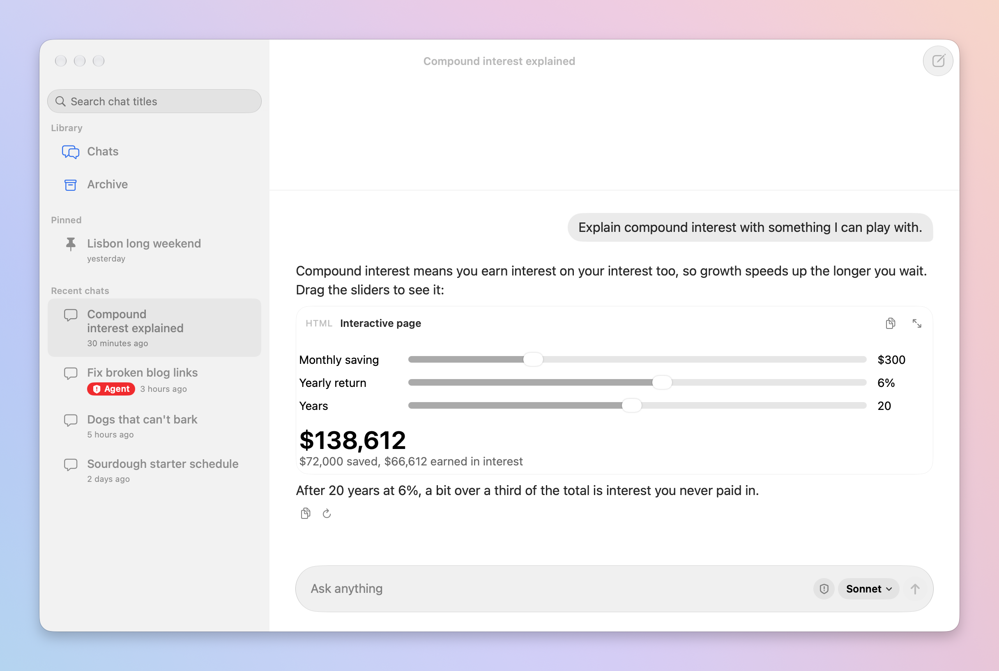
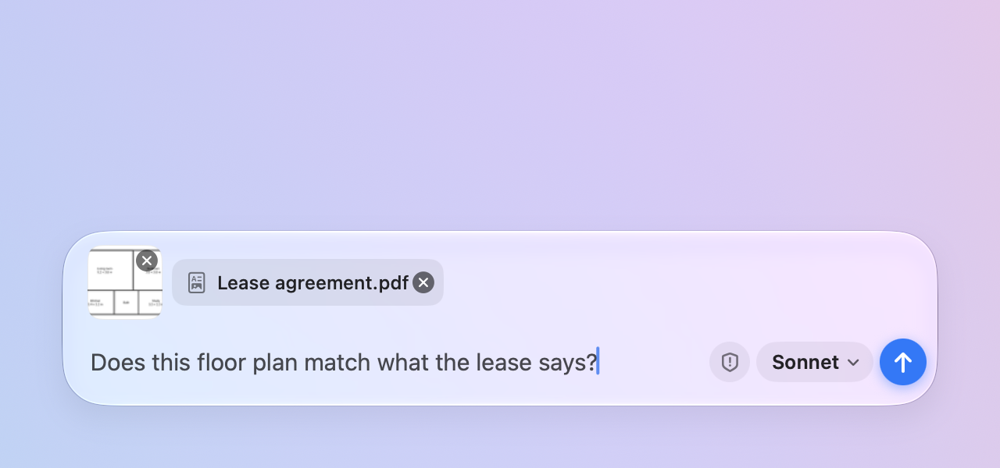
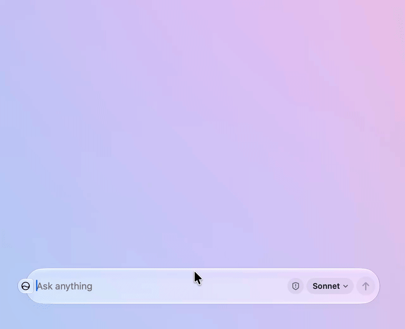
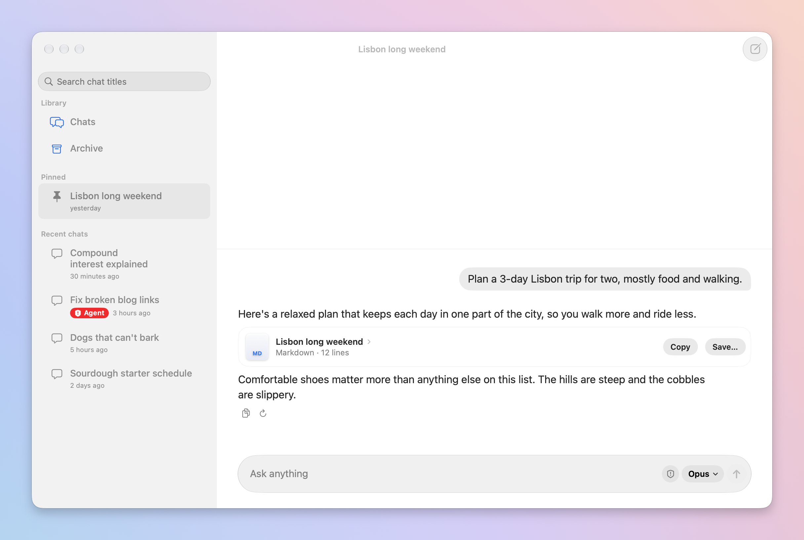
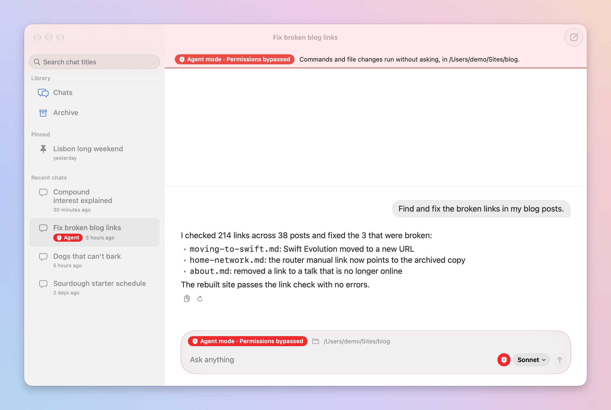

<p align="center">
  
</p>

<h1 align="center">ReGlance</h1>

<p align="center">
  <b>Ask Claude, Codex or OpenCode without leaving what you're doing.</b><br>
  Press ⌥Space over any app, ask, and get back to work.
</p>

<p align="center">
  
  
  
  
</p>

<p align="center">
  <picture>
    <source media="(prefers-color-scheme: dark)" srcset="docs/images/hero-dark.gif">
    
  </picture>
</p>

```sh
brew tap mrRedSun/reglance https://github.com/mrRedSun/reglance
brew install mrRedSun/reglance/reglance
```

Needs macOS 26 on Apple Silicon and a [Claude Code](https://code.claude.com/docs/en/setup) login. Codex and OpenCode are optional extras. [Full install steps](#install) below.

## What it is

ReGlance is a small native Mac app for the quick questions you'd otherwise open a browser tab for. The bar floats over whatever you're doing, full-screen apps included. The answer grows up out of it, and Esc puts it away. Every chat is saved, so you can pick one up later in the chats window.

It runs on the Claude Code login you already have, and on Codex and OpenCode if you use them, so there's no API key to paste. It's built with AppKit and SwiftUI: no Electron and no web wrapper.

## Features

<table>
  <tr>
    <td width="50%">
      <picture>
        <source media="(prefers-color-scheme: dark)" srcset="docs/images/widgets-dark.png">
        
      </picture>
    </td>
    <td>
      <h3>Answers you can use</h3>
      Replies can include charts, documents you can save as Markdown, and small interactive pages like calculators and quizzes. The pages run in a sandbox with no network access.
    </td>
  </tr>
  <tr>
    <td>
      <picture>
        <source media="(prefers-color-scheme: dark)" srcset="docs/images/attachments-dark.png">
        
      </picture>
    </td>
    <td>
      <h3>Paste a screenshot, drop a PDF</h3>
      Paste with ⌘V or drop files onto the bar. Images, PDFs and text files go to Claude with your question.
    </td>
  </tr>
  <tr>
    <td>
      <picture>
        <source media="(prefers-color-scheme: dark)" srcset="docs/images/picker-dark.gif">
        
      </picture>
    </td>
    <td>
      <h3>Claude, Codex and OpenCode in one picker</h3>
      Haiku for a quick fact, Opus at high effort for a hard question, or a GPT or GLM model through Codex and OpenCode. The picker lists each CLI's newest models, and each chat remembers what it used.
    </td>
  </tr>
  <tr>
    <td>
      <picture>
        <source media="(prefers-color-scheme: dark)" srcset="docs/images/chats-dark.png">
        
      </picture>
    </td>
    <td>
      <h3>Every chat, saved on your Mac</h3>
      Continue any chat from the floating bar or the chats window. Pin, rename, archive or delete chats from the sidebar.
    </td>
  </tr>
  <tr>
    <td>
      <picture>
        <source media="(prefers-color-scheme: dark)" srcset="docs/images/agent-dark.png">
        
      </picture>
    </td>
    <td>
      <h3>Agent mode, when you ask for it</h3>
      Switch it on (⌘⇧A) and Claude works in a folder you pick, with your full Claude Code setup. Agent mode runs on Claude Code; a Codex or OpenCode model comes back when you switch it off. It runs in auto mode, glowing blue, so you always know which mode you're in.
    </td>
  </tr>
</table>

## Safe by default

- Ordinary chats can search the web and read web pages, nothing else, on every backend. The model can't open your files or run commands, and a chat that tries anything else stops.
- Your Claude Code, Codex and OpenCode MCP servers, plugins, skills and project instructions stay out of ordinary chats. Codex still reads your global `~/.codex/AGENTS.md`, which it has no setting to skip.
- Chats are JSON files in `~/Library/Application Support/Reglance`. ReGlance has no server and no analytics.
- Agent mode is off for every new chat, and it asks you to confirm the first time you turn it on.
- Agent chats run in Claude Code's auto mode, which blocks risky actions. Skipping permission checks entirely is a separate opt-in in Settings.

## Install

You need macOS 26 or later on Apple Silicon, [Homebrew](https://brew.sh), and Apple's command line tools (`xcode-select --install` if you don't have Xcode).

1. Install [Claude Code](https://code.claude.com/docs/en/setup) and run `claude` once in a terminal to log in.
2. Install ReGlance:

   ```sh
   brew tap mrRedSun/reglance https://github.com/mrRedSun/reglance
   brew install mrRedSun/reglance/reglance
   ln -sf "$(brew --prefix)/opt/reglance/ReGlance.app" /Applications/ReGlance.app
   open /Applications/ReGlance.app
   ```

3. Press ⌥Space.
4. Optional: install [Codex](https://developers.openai.com/codex) (`brew install --cask codex`, then `codex login`) or [OpenCode 2](https://opencode.ai) (`brew install opencode`, then `opencode auth login`). Their models appear in the picker; for OpenCode, choose which ones under Settings › Providers.

Homebrew builds the app on your Mac, which takes about a minute. Because it's built locally, macOS opens it without the "unidentified developer" warning. The app isn't notarized by Apple and isn't in the official Homebrew catalog.

<details>
<summary>Update or uninstall</summary>

```sh
brew update && brew upgrade reglance
```

```sh
brew uninstall reglance
rm /Applications/ReGlance.app
brew untap mrRedSun/reglance
```

Your chats stay in `~/Library/Application Support/Reglance`. Delete that folder to remove them too.

</details>

## Keyboard shortcuts

| Key | Action |
| --- | --- |
| ⌥Space | Show or hide the bar (change it in Settings) |
| Return | Send |
| ⇧Return or ⌥Return | New line |
| Esc | Hide the bar |
| ⌘N | New chat |
| ⌘O | Open the chat in the chats window |
| ⌘⇧A | Turn agent mode on or off (starts a new chat) |
| ⌘, | Settings |

## More details

<details>
<summary>Chats, models and settings</summary>

Right-click a chat in the sidebar to rename, pin, archive or delete it. Pinned chats stay at the top. Archived chats are under Archive and can be unarchived. Delete asks for confirmation and removes the chat's saved messages and attachment copies, but leaves the Claude CLI's own session history alone.

The model picker has a section for each backend and separate Model and Effort choices. Models, their names and the efforts they accept come from each CLI, and only the newest of each Claude and OpenAI family is offered. Automatic uses the CLI's default effort. A chat stays on the backend it started on.

The floating bar reopens on your last chat. After it has been hidden for 5 minutes it starts a new one; your draft stays, and you can change the wait or turn it off in Settings. Drag the floating bar by its title, or by the top or left edge of the collapsed bar. Images are scaled down to 1568px on the long edge. PDFs and other files can be up to 10 MB, and text files up to 1 MB.

ReGlance is a regular Mac app with a Dock icon, a chats window and a menu bar icon. Closing the chats window keeps the bar available; ⌘Q quits. Settings has three tabs. General: Open at login, the ⌥Space shortcut, when the bar starts a new chat, and personal preferences. Agent Mode: permissions. Providers: whether Claude Code, Codex and OpenCode are installed and signed in (with the full `claude doctor` report), a switch to turn Codex or OpenCode off, and which OpenCode models the picker shows.

Under Personal Preferences, tell Claude about yourself and how you like answers: your language, expertise or tone. ReGlance adds them to the system prompt of every chat, agent chats included, starting with your next message.

</details>

<details>
<summary>Agent mode in full</summary>

In agent mode, Claude runs as Claude Code normally does in a folder you choose: the default system prompt, your settings, CLAUDE.md, skills, hooks, plugins, MCP servers and local tools. Agent chats run in **auto mode** (`--permission-mode auto`): Claude Code checks each action, runs the ones it judges safe without asking, and blocks risky ones. They glow blue and carry an "Agent mode · Auto" label.

If you want every action to run without a check, turn on **Bypass permissions** in Settings (`--permission-mode bypassPermissions`). New agent chats then glow red with an "Agent mode · Permissions bypassed" label. The red styling is a warning, not a sandbox.

A chat keeps the mode and permissions it was created with. Follow-ups in an agent chat stay in its folder, and an ordinary chat never gets agent permissions. Switching the toggle while a chat is open starts a new chat. The sidebar badge shows which agent chats are which. The stop button ends the `claude` process and the commands it started.

ReGlance doesn't request Accessibility or Screen Recording access itself. macOS asks only if a tool you configured needs it.

</details>

<details>
<summary>How it works</summary>

ReGlance runs the CLIs you already have, headless and with a short system prompt: `claude -p` with only the WebSearch and WebFetch tools, `codex app-server` with every tool but web search switched off and a read-only sandbox, and a private `opencode serve` whose permissions deny everything but web fetch and search. They use your existing logins. Each reply streams back as JSON and renders natively. Charts use Swift Charts, and interactive pages use a sandboxed web view that loads only when it's on screen.

[CONTRIBUTING.md](CONTRIBUTING.md) has the full technical details.

</details>

## Contributing

Bug reports and pull requests are welcome. [CONTRIBUTING.md](CONTRIBUTING.md) covers building from source, tests, demo mode and the code layout.

## License

[MIT](LICENSE). ReGlance is an independent project and isn't affiliated with Anthropic.
